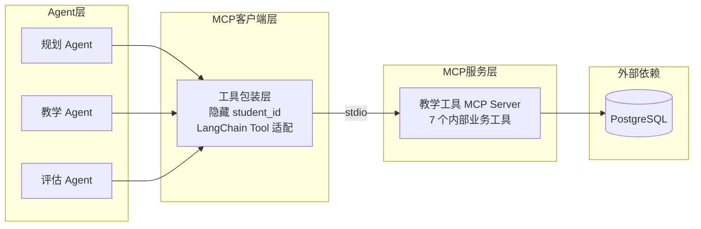
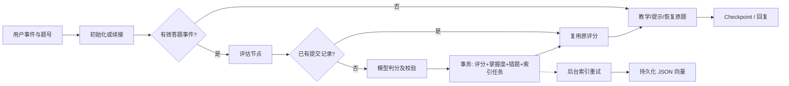

# 架构与取舍

## 职责边界

- domain：题目、评分和确定性的学习策略，不依赖 UI 或数据库。
- agents：模型提示词、工具配置和惰性构建工厂。
- graph：控制状态流转；pending_exercise、input_event 和提交题号共同决定路由。
- services：答题业务事务。
- retrieval：向量计算、持久化、个人数据过滤和索引重试。
- db：数据库资源、ORM、查询与增量建表。
- bootstrap：持久化连接、索引线程及关闭过程。
- ui：输入校验、学生/会话选择、展示和原题号提交。
- mcp：MCP 服务层，包含教学工具 Server 和客户端封装。

## MCP 工具服务层

### 架构

### 设计说明

- **MCP Server**：教学工具（内部业务解耦），掌握度、错题、课程查询统一走 MCP。
- **工具权限隔离**：规划 Agent 4 个工具、教学 Agent 5 个工具、评估 Agent 2 个工具，各自只能看到权限内的子集。
- **身份安全**：MCP 工具本身带 student_id 参数，但经过客户端包装层后，模型侧 schema 中不暴露 student_id，身份从 RunnableConfig 自动注入。
- **可插拔**：`USE_MCP_TOOLS` 环境变量控制是否启用 MCP 工具路径，关闭时回退到本地 LangChain 工具（测试使用）。

### 为什么用 MCP 而不是直接函数调用

- 本项目规模下，MCP 是架构练习而非生产必需。
- 价值在于：工具与 Agent 框架解耦、标准化协议、权限边界清晰、支持独立部署扩展。
- 面试时应说明：这是有意识的架构取舍，知道何时该用何时不该用。

## 一轮答题

## 事务与恢复

使用 (student_id, exercise_id) 唯一键记录第一次成功提交的评分。
如果模型调用成功但业务写入失败，可以重新执行；如果业务已提交但 checkpoint 尚未完成，重试会读取原评分，不再次更新掌握度。

PostgreSQL 中对学生行加锁，以防该学生在不同会话的掌握度更新相互覆盖。
SQLite 测试覆盖回滚和幂等语义，但没有验证 PostgreSQL 的实际并发时序。

embedding 调用独立于答题事务。索引失败记录异常类型、次数与退避时间，后台线程逐条重试。
向量保存于数据库，重启无需重新计算已完成的文档向量；模型名变化时重新索引。

当前后台任务适配单应用进程。多进程需要增加任务租约或 SKIP LOCKED 领取机制，避免重复 embedding 开销。
会话输入在 Gradio 单进程中串行处理，部署多副本前需要额外的同会话锁。

## 为什么暂时不加 pgvector

已有 PostgreSQL 足以保存小规模向量。SQL 先按学生过滤，再用 Python 对个人错题计算相似度。
这个方案减少扩展部署要求，也便于测试重试与隔离。代价是需要加载该学生全部候选向量，规模增长后应使用 pgvector 索引。

向量相似度只表示语义接近。判断重复语法错误还要检查知识点与错误类型；该能力需要真实检索评测，不能仅凭假 embedding 测试宣称有效。

## 多 Agent 的收益需要测量

规划、教学、评估的角色分离和工具权限不同已经实现。
是否每一轮都需要 ReAct，仍应与固定工具流程/单次模型调用做成本、延迟与质量对照。
temperature=0 可以降低随机性，但不是评分完全确定的保证。

## 兼容性

- 保留 python src/main.py。
- default 会话继续使用旧 thread_id；其他会话使用组合键。
- graph.state.Exercise / GradeResult 路径保留再导出，旧类型序列化兼容有离线测试。
- 本轮没有连接并改写实际 checkpoint；真实 PG 续接仍需独立验证。
- 旧错题 correct_form 可能含反馈要点，不自动猜测并改写历史答案。
- MCP 工具路径可通过 `USE_MCP_TOOLS=false` 关闭，回退到本地 LangChain 工具。
